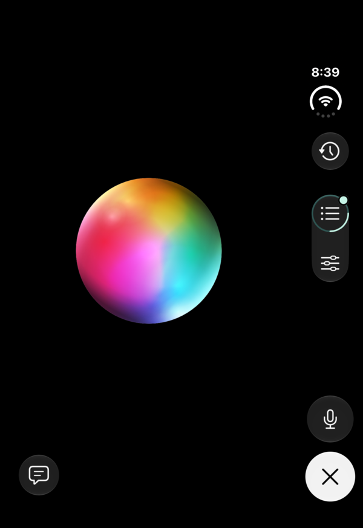
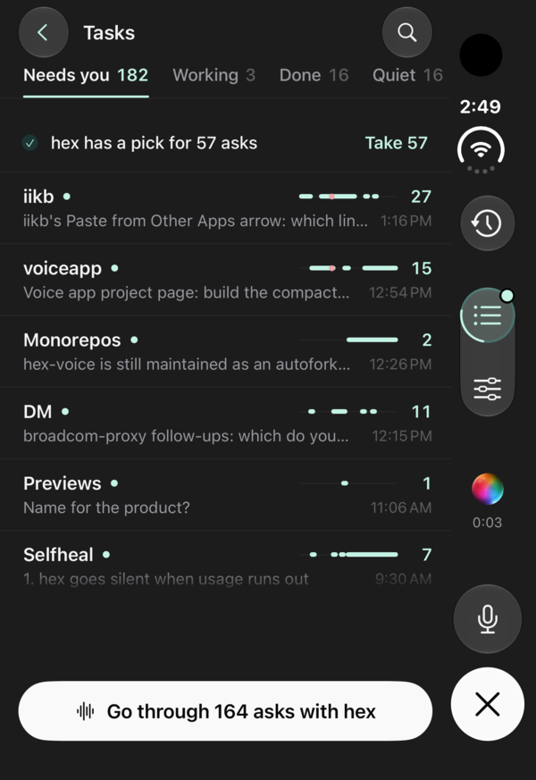
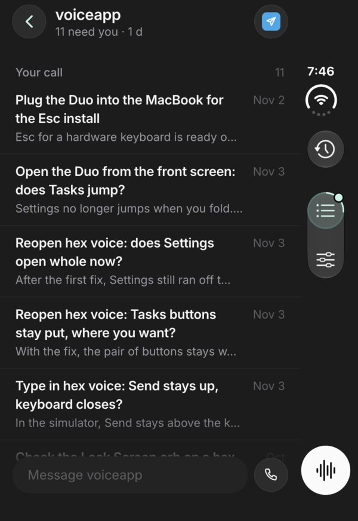

# hex-voice

An iPhone app for calling [hex](https://github.com/AVGVSTVS96/hex), your personal assistant, by voice. You talk with GPT-Live 1; hex's Claude Code session does the real work behind it and tells the voice what to say. Calls keep running with the screen locked, and your orb stays on the Lock Screen and in the Dynamic Island so one tap brings you back. You can talk over replies, pick any GPT-Live voice, and pull the orb down to read the conversation as it happens.

<table>
  <tr>
    <td width="33%"></td>
    <td width="33%"></td>
    <td width="33%"></td>
  </tr>
  <tr>
    <td align="center">On a call</td>
    <td align="center">Tasks</td>
    <td align="center">A project</td>
  </tr>
</table>

Built on David Mokos's [expo-gpt-live](https://github.com/davidmokos/expo-gpt-live) template (MIT): Expo SDK 58, native Expo UI controls, and six [AI Elements Persona](https://elements.ai-sdk.dev/components/persona) animations. It's a personal fork that updates itself with [autofork](https://autofork.com).

```
iPhone ── WebRTC offer ──► hex voice plugin ──► gpt-live-1 session
   ▲                        (over Tailscale)       │ hands requests to
   └──────── audio, captions ◄─────────────────────┘ hex's Claude Code
```

The app has no server or OpenAI key of its own. hex's [voice plugin](https://github.com/AVGVSTVS96/claude-plugins-official/tree/main/external_plugins/voice) starts each session with hex's instructions, so the app, hex's call page and its phone number all reach the same hex.

## Get started

You need hex running with its voice plugin, served to your tailnet (`tailscale serve --bg --https=8790 http://127.0.0.1:8790`), Tailscale on the iPhone, Node.js 22.13+, and macOS with Xcode 26.4+.

```sh
git clone https://github.com/AVGVSTVS96/hex-voice.git
cd hex-voice
npm ci
cp .env.example .env.local   # set EXPO_PUBLIC_HEX_URL to your server's tailnet address
```

Set `ios.bundleIdentifier` in `app.json` to your own, connect and unlock the phone, enable Developer Mode, and run:

```sh
npm run ios:device
```

Expo handles signing and installation. Expo Go cannot run this app because WebRTC and Rive need a native build.

## Development

```sh
npm run check
```

The call is in `src/call`: one `Call` model (`call.ts`), the session's owner at the app's root (`use-call.tsx`) and the call screen and its parts. Native controls and Persona renderers are in `src/components`, and the session and transport in `src/live`, along with the call's Live Activity (`call-activity.tsx`, built with `expo-widgets`). Its orb stills are rendered from the Persona files by `npm run activity-orbs`. See [dependency notes](docs/dependencies.md) for the Xcode workaround.

MIT. Persona assets keep their [upstream license and attribution](src/components/persona/assets/README.md).
